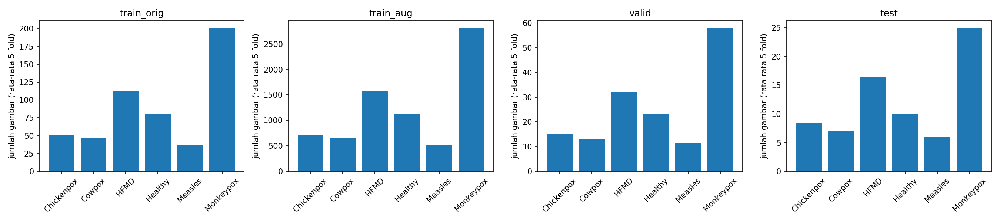
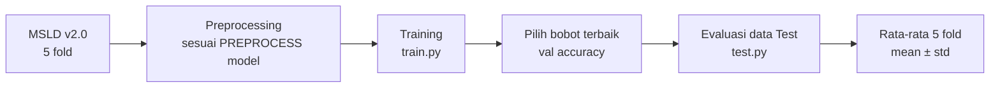
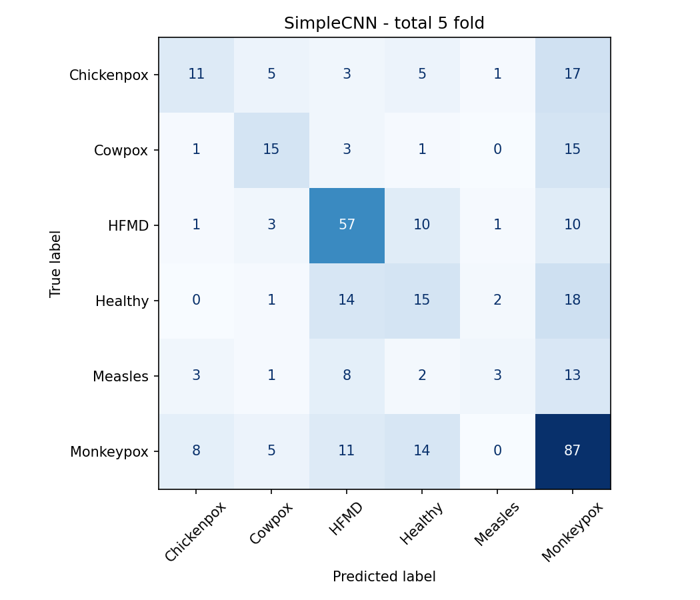
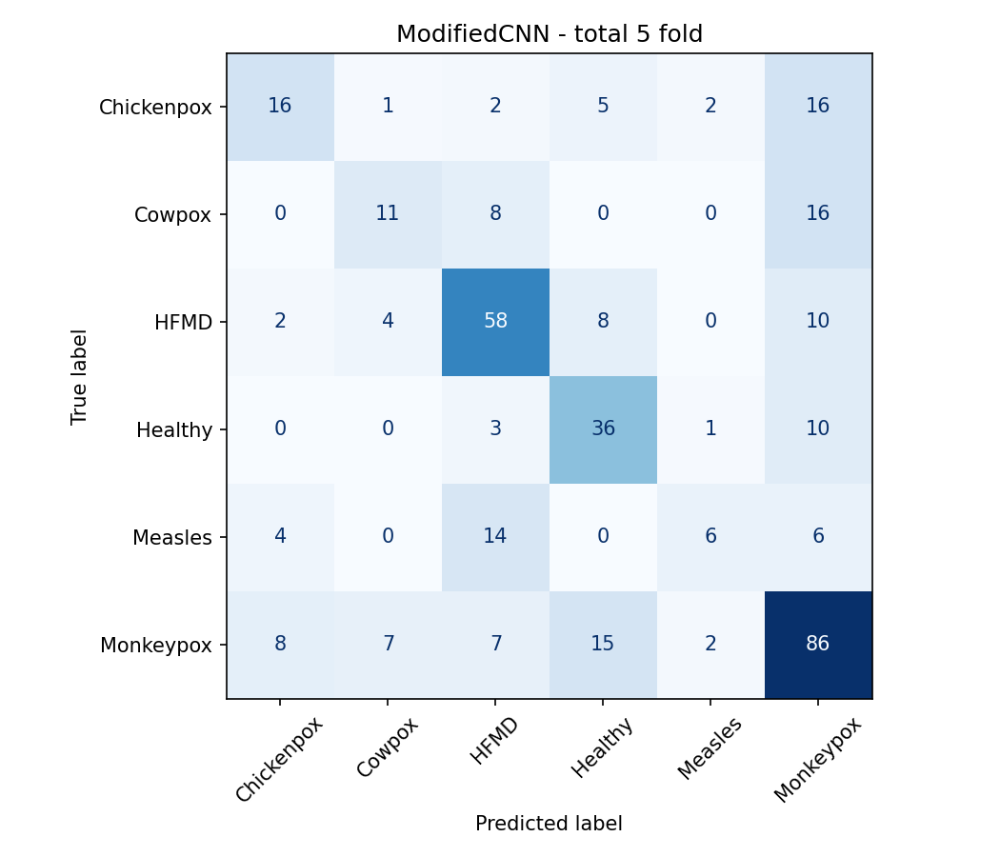
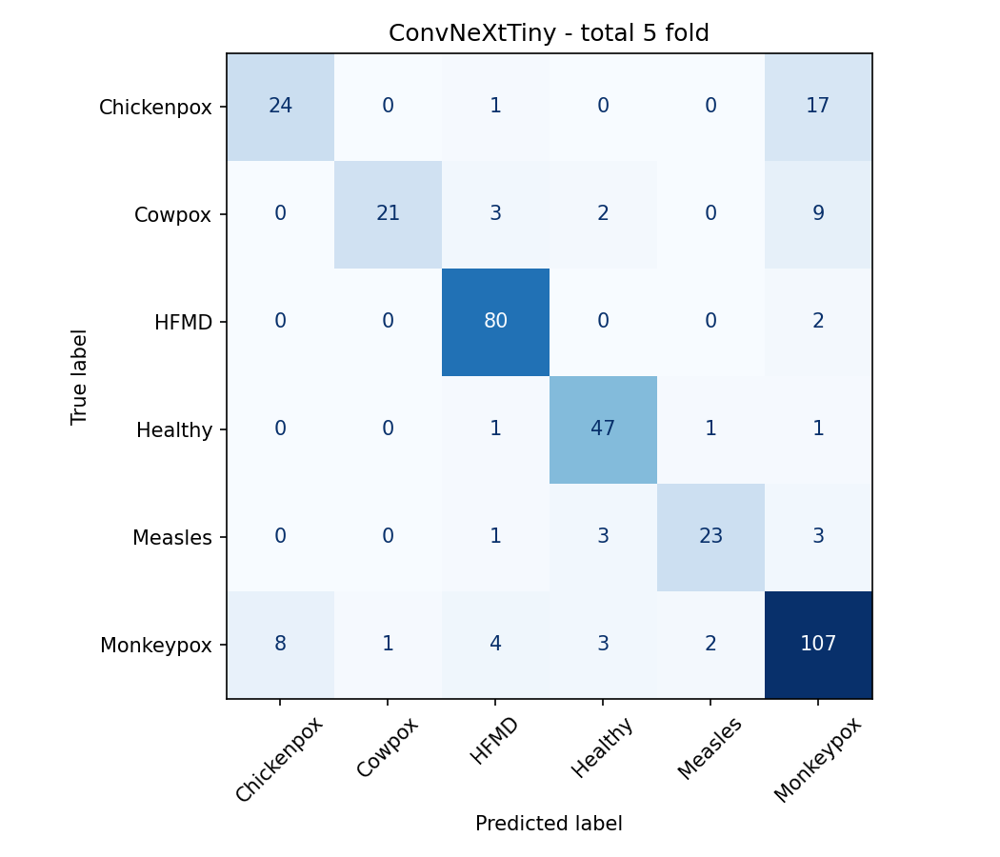
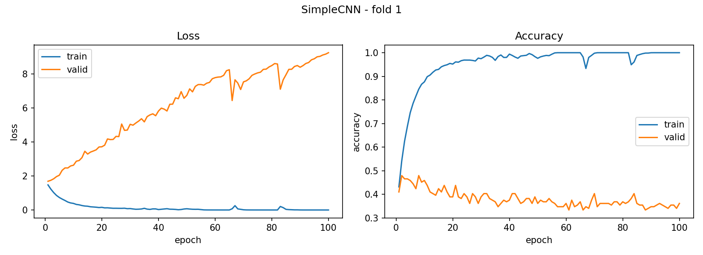
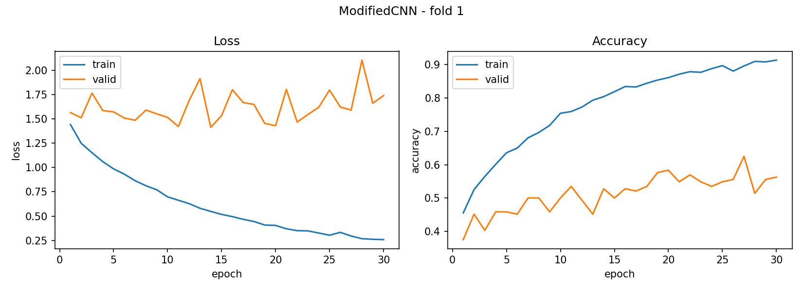
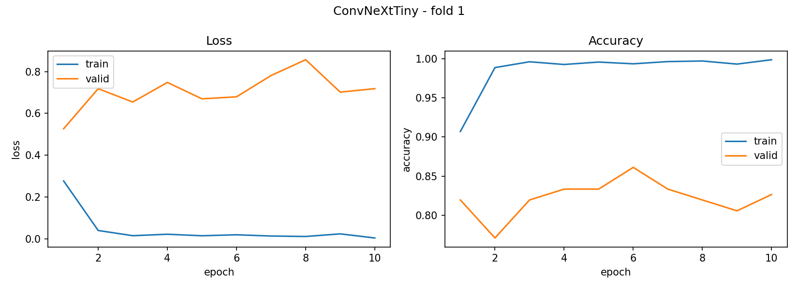

<div align="center">

# 🔬 Klasifikasi Lesi Kulit Mpox dengan CNN

**Perbandingan SimpleCNN, ModifiedCNN, dan ConvNeXt-Tiny pada Mpox Skin Lesion Dataset v2.0**


Project Deep Learning · Praktikum Infrastruktur & Platform Sains Data

</div>

---

## 📌 Ringkasan

Project ini mengklasifikasikan citra lesi kulit ke **6 kelas** (Chickenpox, Cowpox, HFMD, Healthy, Measles, Monkeypox) dan membandingkan tiga pendekatan:

1. **SimpleCNN**: CNN dangkal yang arsitekturnya sama dengan materi M9 (baseline).
2. **ModifiedCNN**: CNN yang lebih dalam, dengan BatchNorm dan Dropout.
3. **ConvNeXt-Tiny**: model pretrained ImageNet yang di-fine-tune penuh.

Semua model dievaluasi dengan **5-fold** bawaan dataset pada data **Test** yang tidak pernah dipakai saat training.

<div align="center">

| 🏆 Model terbaik | Accuracy | Macro F1 | ROC-AUC |
|:---:|:---:|:---:|:---:|
| **ConvNeXt-Tiny** | **0.831** | **0.807** | **0.968** |

</div>

---

## 🧾 Daftar Isi

- [Dataset](#-dataset)
- [Pipeline](#-pipeline)
- [Model](#-model)
- [Setting Training](#-setting-training)
- [Hasil](#-hasil)
- [Analisis & Temuan](#-analisis--temuan)
- [Cara Menjalankan](#-cara-menjalankan)
- [Struktur Repo](#-struktur-repo)
- [Referensi](#-referensi)

---

## 📂 Dataset

**[Mpox Skin Lesion Dataset Version 2.0 (MSLD v2.0)](https://www.kaggle.com/datasets/joydippaul/mpox-skin-lesion-dataset-version-20-msld-v20)**

| Kelas | Citra asli | Proporsi |
|---|---:|---:|
| Monkeypox | 284 | 37,6% |
| HFMD | 161 | 21,3% |
| Healthy | 114 | 15,1% |
| Chickenpox | 75 | 9,9% |
| Cowpox | 66 | 8,7% |
| Measles | 55 | 7,3% |
| **Total** | **755** | |

Kelasnya **tidak seimbang**: Monkeypox sekitar 5 kali lebih banyak daripada Measles.

**Pembagian per fold** (5 fold bawaan dataset):

| Split | Isi | Contoh jumlah (fold 1) |
|---|---|---:|
| Train | Original `fold{k}/Train` + Augmented `fold{k}_AUG/Train` | 537 + 7.518 = **8.055** |
| Valid | Original `fold{k}/Valid` | 144 |
| Test | Original `fold{k}/Test` | 74 |

Data valid dan test hanya berisi citra asli dan tidak ikut training. Distribusi lengkap per fold ada di [`Results/distribusi_data.csv`](Results/distribusi_data.csv).

<div align="center">

</div>

> Dataset tidak di-upload ke repo. Lihat [`Dataset/README.md`](Dataset/README.md).

---

## 🔄 Pipeline



**Preprocessing:** PIL → RGB → resize kotak → `ToTensor` (piksel 0–1). Tanpa augmentasi on-the-fly, karena dataset sudah menyediakan data augmentasi.

Setting preprocessing ditaruh di **atribut `PREPROCESS` di file masing-masing model**, lalu dibaca oleh `Utils/getData.py`:

| Model | `size` | `bgr` | `normalize` (ImageNet) |
|---|:---:|:---:|:---:|
| SimpleCNN | 100 | ✅ | ❌ |
| ModifiedCNN | 224 | ❌ | ❌ |
| ConvNeXt-Tiny | 224 | ❌ | ✅ |

---

## 🧠 Model

| | SimpleCNN | ModifiedCNN | ConvNeXt-Tiny |
|---|---|---|---|
| **Jumlah parameter** | **50.876** | **848.038** | **27.824.742** |
| Bobot awal | Acak | Acak | Pretrained ImageNet-1K |
| Lapisan konvolusi | 2 (kernel 5×5) | 7 (kernel 3×3) | 18 blok ConvNeXt (depthwise 7×7) |
| Normalisasi | – | BatchNorm | LayerNorm |
| Regularisasi | – | Dropout2d 0,1–0,2 + Dropout 0,35 | Weight decay 0,05 + stochastic depth |
| Output | FC 4050→6 + **Softmax** | FC 1024→256→6 (logits) | Linear 768→6 (logits) |

<details>
<summary><b>SimpleCNN</b> — <code>Models/CNN.py</code></summary>

Identik dengan arsitektur M9; yang diubah hanya jumlah kelas output (5 → 6).

```
Input 3×100×100
→ Conv 3→20 (5×5) → ReLU → MaxPool 3×3
→ Conv 20→50 (5×5) → ReLU → MaxPool 3×3
→ Flatten (50×9×9 = 4050) → Linear 4050→6 → Softmax
```
</details>

<details>
<summary><b>ModifiedCNN</b> — <code>Models/ModifiedCNN.py</code></summary>

```
Input 3×224×224
→ [Conv 3→32, BN, ReLU] ×2 → MaxPool 2
→ [Conv 32→64, BN, ReLU] ×2 → MaxPool 2 → Dropout2d 0.10
→ [Conv 64→128, BN, ReLU] ×2 → MaxPool 2 → Dropout2d 0.15
→ Conv 128→256, BN, ReLU → AdaptiveAvgPool 2×2 → Dropout2d 0.20
→ Linear 1024→256 → BN → ReLU → Dropout 0.35 → Linear 256→6
```
</details>

<details>
<summary><b>ConvNeXt-Tiny</b> — <code>Models/ConvNeXt.py</code></summary>

`torchvision.models.convnext_tiny` dengan bobot `IMAGENET1K_V1`. Layer klasifikasi terakhir (768→1000) diganti menjadi 768→6, lalu **semua layer di-fine-tune**.
</details>

---

## ⚙️ Setting Training

| | SimpleCNN | ModifiedCNN | ConvNeXt-Tiny |
|---|:---:|:---:|:---:|
| Loss | NLL dari log(Softmax) ≡ Cross-Entropy | Cross-Entropy | Cross-Entropy |
| Optimizer | Adam | Adam | AdamW |
| Learning rate | 1e-3 | 1e-3 | 1e-4 |
| Weight decay | 0 | 0 | 0,05 |
| Batch size | 32 | 32 | 32 |
| Epoch | 100 | 30 | 10 |
| Pemilihan bobot | Val accuracy terbaik | Val accuracy terbaik | Val accuracy terbaik |
| Total waktu (5 fold, GPU T4) | ±98 menit | ±138 menit | ±152 menit |

Seed tetap, dan GPU Kaggle Tesla T4.

---

## 📊 Hasil

### Perbandingan keseluruhan

Data **Test**, metrik **macro**, rata-rata 5 fold ± standar deviasi.

| Model | Accuracy | Precision | Recall | F1-score | ROC-AUC |
|---|:---:|:---:|:---:|:---:|:---:|
| SimpleCNN | 0.516 ± 0.069 | 0.462 ± 0.146 | 0.417 ± 0.073 | 0.410 ± 0.090 | 0.777 ± 0.059 |
| ModifiedCNN | 0.585 ± 0.017 | 0.555 ± 0.020 | 0.512 ± 0.033 | 0.504 ± 0.030 | 0.833 ± 0.017 |
| **ConvNeXt-Tiny** | **0.831 ± 0.051** | **0.864 ± 0.044** | **0.795 ± 0.069** | **0.807 ± 0.068** | **0.968 ± 0.013** |

### F1-score per kelas (rata-rata 5 fold)

| Kelas | SimpleCNN | ModifiedCNN | ConvNeXt-Tiny |
|---|:---:|:---:|:---:|
| Chickenpox | 0.300 | 0.416 | **0.644** |
| Cowpox | 0.449 | 0.406 | **0.749** |
| HFMD | 0.641 | 0.662 | **0.929** |
| Healthy | 0.315 | 0.624 | **0.898** |
| Measles | 0.147 | 0.277 | **0.812** |
| Monkeypox | 0.607 | 0.640 | **0.812** |

### Confusion matrix (gabungan 5 fold)

| SimpleCNN | ModifiedCNN | ConvNeXt-Tiny |
|:---:|:---:|:---:|
|  |  |  |

### Kurva training (fold 1)

| SimpleCNN | ModifiedCNN | ConvNeXt-Tiny |
|:---:|:---:|:---:|
|  |  |  |

Hasil per fold, ROC, dan classification report lengkap ada di folder [`Results/`](Results/).

---

## 💡 Analisis & Temuan

### 1. Pretrained menang telak
ConvNeXt-Tiny unggul di **semua metrik dan semua kelas**: F1 0.807, sekitar 0,3 di atas ModifiedCNN. Peningkatan terbesar ada di kelas minoritas, misalnya **Measles** (0.147 → 0.277 → **0.812**). Fitur umum dari ImageNet (tepi, tekstur, pola warna) membuat model tetap bisa menggeneralisasi walaupun datanya sedikit.

### 2. Semua model overfit, tapi dampaknya berbeda
| Model | Train acc akhir | Epoch terbaik | Val acc terbaik |
|---|:---:|:---:|:---:|
| SimpleCNN | ~1.00 | 2–35 | 0.46–0.53 |
| ModifiedCNN | ~0.90 | 27–30 | 0.61–0.63 |
| ConvNeXt-Tiny | ~0.99 | 2–8 | 0.81–0.90 |

- **SimpleCNN** hafal data train (acc 1.0) sejak sekitar epoch 55, sementara val loss terus naik (1.7 → 9+). Val acc tertinggi sudah tercapai di epoch-epoch awal.
- **ConvNeXt** juga mencapai train acc ~0.99 di epoch 2, tapi val acc-nya tetap tinggi. Model ini menghafal sekaligus tetap menggeneralisasi.
- **ModifiedCNN** masih membaik sampai epoch 30 (epoch terbaik 27–30), jadi kemungkinan masih bisa naik kalau dilatih lebih lama.

Artinya, ukuran model bukan penentu utama. Yang membuat beda adalah kualitas fitur yang dipelajari.

### 3. Bias ke kelas mayoritas
Model yang dilatih dari nol cenderung menebak **Monkeypox**, kelas terbanyak. Di SimpleCNN, 160 dari 364 citra test diprediksi Monkeypox. Measles hanya benar 3 dari 30, dan 13 di antaranya ditebak Monkeypox.

### 4. Kasus Softmax ganda pada SimpleCNN
SimpleCNN (mengikuti M9) sudah punya **Softmax di lapisan terakhir**. Kalau digabung dengan `nn.CrossEntropyLoss`, yang di dalamnya sudah menjalankan log-softmax, softmax terpakai **dua kali**:

```
CrossEntropy(Softmax(z)) = −log softmax(softmax(z))   ← gradien hampir nol
```

Pada percobaan awal di MSLD, model **beku sejak epoch 1**: loss konstan sekitar 1.67 dan selalu memprediksi Monkeypox (train acc 0.376 = proporsi Monkeypox). Solusinya, **arsitektur tetap dibiarkan sama dengan M9**, dan loss dihitung sebagai:

```python
loss = F.nll_loss(torch.log(prob.clamp_min(1e-30)), target)   # ProbNLLLoss di train.py
```

Rumus ini setara secara matematis dengan cross-entropy biasa pada logits, tapi softmax hanya dijalankan sekali.

---

## 🚀 Cara Menjalankan

### Di Kaggle (disarankan)
Setting notebook: **Accelerator GPU**, **Internet On**, dan dataset MSLD v2.0 ditambahkan lewat *Add Input*.

```bash
!git clone https://github.com/xenoo-droid/project_DL_IPSD.git
%cd project_DL_IPSD

# training 5 fold, lalu evaluasi di data test
!python train.py --model SimpleCNN    --epochs 100 --num_workers 4
!python test.py  --model SimpleCNN    --num_workers 4

!python train.py --model ModifiedCNN  --epochs 30  --num_workers 4
!python test.py  --model ModifiedCNN  --num_workers 4

!python train.py --model ConvNeXtTiny --epochs 10  --num_workers 4
!python test.py  --model ConvNeXtTiny --num_workers 4

!zip -r /kaggle/working/results.zip Results
```

### Opsi argumen

| Argumen | Default | Keterangan |
|---|---|---|
| `--model` | (wajib) | `SimpleCNN`, `ModifiedCNN`, `ConvNeXtTiny` |
| `--folds` | `1 2 3 4 5` | contoh: `--folds 1` untuk coba 1 fold |
| `--epochs` | 30 (ConvNeXt: 15) | jumlah epoch |
| `--batch_size` | 32 | |
| `--num_workers` | 2 | worker DataLoader |
| `--root` | path Kaggle | lokasi dataset |

### Lokal
```bash
pip install -r requirements.txt
python train.py --model ConvNeXtTiny --root "path/ke/dataset" --folds 1
```

### Menambah model baru
1. Buat `Models/NamaModel.py` berisi class yang menerima argumen `num_classes` (opsional: atribut `PREPROCESS`).
2. Tambahkan satu baris di dict `MODELS` di `train.py`.

---

## 🗂️ Struktur Repo

```
Models/             # tiap model punya atribut PREPROCESS sendiri (size, bgr, normalize)
  CNN.py            # SimpleCNN
  ModifiedCNN.py    # ModifiedCNN
  ConvNeXt.py       # ConvNeXtTiny
Utils/
  getData.py        # Dataset & DataLoader, transform-nya mengikuti PREPROCESS model
train.py            # training 5-fold, simpan bobot terbaik (val accuracy)
test.py             # evaluasi di data Test tiap fold + rata-rata
Results/
  01_SimpleCNN/     # history, kurva, confusion matrix, ROC, report, metrik
  02_ModifiedCNN/
  03_ConvNeXtTiny/
  distribusi_data.csv / .png
Dataset/            # tempat dataset lokal (tidak di-push)
```

Isi tiap folder `Results/<model>/`:

| File | Isi |
|---|---|
| `fold{k}_history.csv`, `fold{k}_curve.png` | loss & accuracy per epoch |
| `fold{k}_confusion_matrix.png`, `fold{k}_roc.png`, `fold{k}_report.txt` | evaluasi per fold |
| `confusion_matrix_total.png` | confusion matrix gabungan 5 fold |
| `metrics_per_fold.csv`, `metrics_summary.csv` | metrik per fold & mean ± std |
| `f1_per_class.csv`, `train_summary.csv` | F1 per kelas, epoch terbaik & durasi |

---

## 📚 Referensi

- Paul, J. *Mpox Skin Lesion Dataset Version 2.0 (MSLD v2.0)*. Kaggle.
- Liu, Z. et al. (2022). *A ConvNet for the 2020s*. CVPR.
- Materi M9 *Deep Learning Menggunakan Python*, Praktikum Infrastruktur & Platform Sains Data.
